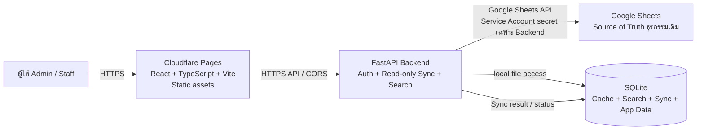

# Goodwill – System Scope & Data Ownership

วันที่จัดทำ: 17 พฤศจิกายน 2026  
สถานะ: ข้อเสนอสำหรับกำหนดขอบเขตระบบ โดยยึดการตัดสินใจที่ผู้ใช้ยืนยันแล้ว และทำเครื่องหมาย Unknown / Pending Decision ในจุดที่หลักฐานหรือกติกายังไม่พอ

## 1. ข้อกำหนดที่ยืนยันแล้ว

- ระบบเป็น Hybrid: Inventory + Delivery Management
- Google Sheets เป็น Source of Truth สำหรับข้อมูลธุรกรรมเดิมในระยะแรก
- SQLite เก็บ Cache, Search, Sync Status และข้อมูลประกอบระบบ
- Backend ใช้ Python + FastAPI; Frontend ใช้ React + TypeScript + Vite
- ผู้ใช้ประมาณ 2–3 คน; มี Roles คือ Admin / Staff
- Backend เป็นส่วนเดียวที่เชื่อมต่อ Google Sheets
- เริ่มต้นด้วย Read-only Sync; เว็บไซต์ยังไม่เขียนกลับ Google Sheets
- Cloudflare Pages ใช้เสิร์ฟ Frontend แบบ static; FastAPI ทำงานเป็นบริการ Backend แยกต่างหาก

## 2. หลักฐานข้อมูลที่ใช้กำหนด Scope

เอกสารวิเคราะห์ 01–10 ตรวจสอบชุด Export ที่มี 464 Worksheets: 460 ชีตกลุ่มธุรกรรม/ล็อต, 2 ชีต Sales Team, 1 Lot Report และ 1 แบบฟอร์ม ตามเอกสาร 02 และรายการในเอกสาร 01 ข้อมูลเหล่านี้สนับสนุนการทำหน้าค้นหาและอ่านข้อมูลเดิม แต่ยังไม่เพียงพอจะสรุปยอดคงเหลือปัจจุบันหรือประวัติการเคลื่อนไหวสินค้า

ประเด็นสำคัญที่ยังไม่ยืนยันจากรายงานและ CSV ได้แก่ ความหมายและกติกาการซ้ำของ INV, ความสัมพันธ์ระหว่าง INV กับ Bill, grain และกฎต่อแถวของ Lot Report, วัตถุประสงค์ของ Sales Team V2 เทียบกับ Legacy, ความหมายของวันที่, หน่วยสินค้า และการจับคู่ชื่อสินค้า ดูรายการตัดสินใจค้างในเอกสาร 10

**ขอบเขตข้อมูล Stock:** ไม่พบหลักฐานที่ยืนยันว่า Google Sheets Export มี Stock Balance หรือ Stock Movement ที่ครบถ้วนและเป็นแหล่งข้อมูลจริง จึงไม่ถือว่ามีข้อมูลดังกล่าวอยู่แล้ว และไม่ควรทำ Dashboard ยอดคงเหลือจากการบวกข้อมูลธุรกรรมโดยยังไม่มีกติกา

## 3. System Scope ตามระยะ

| ฟังก์ชัน | ระยะ | ขอบเขตที่เสนอ | เงื่อนไข / ข้อมูลที่ยังขาด |
|---|---|---|---|
| Google Sheets Integration | Core MVP | อ่านชีตตามรายการที่อนุมัติ, นำเข้าแบบ Read-only, บันทึกสถานะและข้อผิดพลาด | ต้องกำหนดบัญชี/สิทธิ์เข้าถึงและความถี่ซิงก์; ห้าม Frontend ติดต่อ Google API โดยตรง |
| INV Search | Core MVP | ค้นหา INV จากข้อมูลที่ซิงก์และแสดงแหล่งที่มา/Worksheet/เวลาซิงก์ | ต้องแสดงกรณี INV ซ้ำหรือไม่พบโดยไม่เลือกคู่ให้อัตโนมัติ; กติกา INV ยัง Pending |
| User & Permission | Core MVP | เข้าระบบด้วย 2 Roles; จำกัดการกระทำตามสิทธิ์; เริ่มจากสิทธิ์อ่านข้อมูล | Admin/Staff ทำอะไรได้บ้างและวิธีจัดการบัญชีต้องยืนยัน; website ยังไม่มีสิทธิ์เขียนธุรกรรม |
| Dashboard | Core MVP (ขั้นต่ำ) | สถานะการซิงก์, เวลาซิงก์ล่าสุด, จำนวนแถวที่อ่านได้/มีปัญหา | ตัวชี้วัดธุรกิจ, ยอดขาย/คงเหลือ และการนับรายการต้องรอ grain/วันที่/กติกายืนยัน |
| Audit Log | Core MVP (ระบบ) | บันทึกเหตุการณ์เข้าสู่ระบบ, การเริ่ม/จบ Sync, ผลและข้อผิดพลาด, การเปลี่ยนค่าตั้งค่าระบบ | ยังไม่ใช่ประวัติแก้ไขธุรกรรม เพราะเว็บไซต์ไม่เขียนข้อมูลธุรกรรม |
| Bill Management | Phase 2 | ค้นหา/ดูข้อมูล Bill แบบ Read-only ก่อน | ต้องยืนยันว่า Bill คืออะไรและสัมพันธ์กับ INV/แหล่งข้อมูลใด |
| Lot Management | Phase 2 | ดูข้อมูล Lot และรายละเอียดจากชีตที่มีหลักฐาน | ต้องยืนยัน grain, การสืบทอด INV ในแถวต่อเนื่อง และความสัมพันธ์กับ Lot Report |
| Sales Team | Phase 2 | ดูข้อมูล Legacy และ V2 โดยแสดงแหล่งชุดข้อมูลชัดเจน | ต้องตัดสินว่า V2 แทน Legacy หรือใช้คนละวัตถุประสงค์; ห้ามรวมชุดอัตโนมัติ |
| INV Reconciliation | Phase 2 | แสดงรายการที่จับคู่/ไม่จับคู่/กำกวมระหว่างแหล่ง และให้ผู้ใช้ตรวจ | ต้องยืนยันกติกา INV, ความหมายเอกสาร, normalization และชนิดวันที่ก่อนสรุปผลว่า match |
| Store Management | Phase 2 | ค้นหา/ดูข้อมูลร้านค้าที่มีอยู่ในแหล่งเดิม | ต้องกำหนดรหัส/ตัวตนร้านค้า, วิธีรวมชื่อซ้ำ, เจ้าของข้อมูล และสิทธิ์แก้ไข |
| Reports & Export | Phase 2 | รายงานอ่านอย่างเดียวและ Export ที่อ้างอิงข้อมูลต้นทาง | ต้องตกลงความหมายของวันที่, หน่วย, ตัวกรอง, การจัดการค่าว่าง/error และนิยามยอด |
| Stock Management | Phase 2 (หลังยืนยันข้อมูล) | อาจเพิ่มการดูยอดตามสินค้า/สถานที่เมื่อมี Stock Balance ที่เชื่อถือได้ | ต้องกำหนดยอดตั้งต้น, หน่วย, ตำแหน่งเก็บ, วิธีคำนวณ และเจ้าของ Stock Balance; ปัจจุบัน Unknown |
| Stock Movement | Phase 2 (หลังยืนยันกระบวนการ) | อาจบันทึกรับเข้า/จ่าย/โอน/ปรับปรุง/คืนตามชนิดที่เจ้าของระบบยืนยัน | ต้องกำหนดเหตุการณ์, ปริมาณ/หน่วย, สถานที่, ผู้ทำ, เวลา, เอกสารอ้างอิงและผลต่อยอด; ยังไม่พบหลักฐานว่า Sheets มี Movement Log |
| Dashboard เชิงวิเคราะห์ / แจ้งเตือน / รายงานขั้นสูง | Future | เพิ่มหลังข้อมูลหลักและนิยาม KPI เสถียร | ขึ้นกับคุณภาพข้อมูลและความต้องการผู้ใช้จริง |

**แนวทาง Audit:** MVP บันทึกกิจกรรมระบบเท่านั้น เช่น Sync, Login และการเปลี่ยนค่าตั้งค่า ผู้ใช้ยังแก้ธุรกรรมใน Google Sheets ตามกระบวนการเดิมที่ได้รับอนุญาตได้ แต่ website ไม่เขียนกลับ; การทำ audit trail สำหรับการแก้ไขจาก Sheets ต้องยืนยันว่าต้องการประวัติระดับใดและ Sheets มีประวัติที่อ่านผ่าน API ได้ตามต้องการหรือไม่

## 4. Data Ownership Matrix

แยก “ข้อมูลธุรกรรมเดิม” ซึ่งคัดลอกจาก Google Sheets เพื่อค้นหา/แสดงผล ออกจาก “ข้อมูลประกอบระบบ” ซึ่งระบบสร้างและดูแลใน SQLite แถวที่มีสถานะ Pending ยังไม่ถือเป็นการตัดสินความหมายหรือสิทธิ์ทางธุรกิจ

| Data Entity / ชุดข้อมูล | Source of Truth | Data Owner | Read / Write Permission | Sync Direction | Sync Frequency | Storage Location | Validation Requirements |
|---|---|---|---|---|---|---|---|
| ธุรกรรมเดิม/แถวที่มี INV | Google Sheets ต้นฉบับ | เจ้าของข้อมูลธุรกิจที่กำหนดโดย Goodwill (ชื่อผู้รับผิดชอบ Pending) | เว็บไซต์: Admin/Staff อ่าน; เว็บไซต์เขียนไม่ได้. การแก้ต้นฉบับทำใน Sheets โดยผู้ได้รับสิทธิ์จากเจ้าของ | Sheets → Backend → SQLite | เริ่มแบบ manual/on-demand เสนอไว้; ความถี่จริง Pending | Google Sheets ต้นฉบับ + สำเนาอ่านอย่างเดียว/ดัชนีค้นหาใน SQLite | เก็บ Source Worksheet/row, เวลา sync, raw value; ตรวจ header, จำนวนแถว, parse/error, duplicate โดยไม่ auto-merge |
| Bill และการเชื่อม Bill–INV | Google Sheets ที่ระบุหลังยืนยันแหล่ง Bill | เจ้าของกระบวนการ Bill (Pending) | MVP: อ่านอย่างเดียวหากพบในแหล่งที่อนุมัติ; website write: ห้าม | Sheets → SQLite เมื่อ source/range ยืนยัน | ตามรอบ sync ธุรกรรม; Pending | raw/cache ใน SQLite พร้อม source provenance | ตรวจรูปแบบเลขเอกสารและค่าซ้ำ; ความสัมพันธ์ Bill–INV ห้ามกำหนดจนเจ้าของยืนยัน |
| Lot / Lot Report | Google Sheets ต้นฉบับ | เจ้าของกระบวนการ Lot/Delivery (Pending) | MVP/Phase 2: อ่านตาม Role; website write: ห้าม | Sheets → SQLite | Pending (ใช้รอบเดียวกับ read-only sync เมื่ออนุมัติ) | raw/cache ใน SQLite; เก็บลำดับแถวและชื่อชีต | เก็บ raw rows; ตรวจ continuation rows, blank INV, ขอบเขตกลุ่ม และ unmatched โดยไม่สืบทอดค่าอัตโนมัติ |
| Sales Team Legacy / V2 | แต่ละ Google Sheet/Worksheet ต้นฉบับของตนเอง | เจ้าของข้อมูลทีมขาย (Pending) | Admin/Staff อ่านตามสิทธิ์; website write: ห้าม | Sheets → SQLite; เก็บแหล่ง Legacy/V2 แยกกัน | Pending | raw/cache ใน SQLite โดยไม่รวมเป็นชุดเดียว | ตรวจ header/schema version, INV, ค่าว่างและ error; การแทนที่/รวม V2 กับ Legacy Pending |
| ข้อมูลสินค้า/ชื่อสินค้าในธุรกรรม | ค่าต้นฉบับใน Sheets เป็นหลัก จนกว่าจะมี master ที่ยืนยัน | เจ้าของข้อมูลสินค้า (Pending) | อ่าน; canonical mapping แก้ได้โดย Admin หลังได้รับอนุมัติเท่านั้น (ข้อเสนอ) | Sheets → SQLite สำหรับ raw; mapping เป็น local config ไม่มี sync กลับ | raw ตามรอบ sync; mapping เมื่อ Admin ปรับ | raw fields และ mapping/config ใน SQLite แยกกัน | เก็บชื่อต้นฉบับ; ห้ามรวม alias อัตโนมัติ; ตรวจหน่วยและรหัสมาตรฐานเมื่อได้รับอนุมัติ |
| Store/ที่อยู่จาก Sales Team/ธุรกรรม | Sheets ต้นฉบับ; ยังไม่มี store master ที่ยืนยัน | เจ้าของข้อมูลร้านค้า (Pending) | อ่าน; mapping รายการซ้ำโดย Admin หลังยืนยัน (ข้อเสนอ) | Sheets → SQLite สำหรับ raw; mapping local | ตามรอบ sync; cadence Pending | raw/cache + mapping ที่ได้รับอนุมัติใน SQLite | ตรวจชื่อ/ที่อยู่/จังหวัดและค่าว่าง; ไม่ใช้ชื่อร้านเป็น key โดยไม่มีการยืนยัน |
| Stock Balance / Stock Movement | **Unknown — ยังไม่มี Source of Truth ที่ยืนยัน** | เจ้าของคลัง/ผู้รับผิดชอบสต็อก (ต้องระบุ) | ยังไม่เปิดสิทธิ์อ่าน/เขียนเป็นฟังก์ชัน MVP; สิทธิ์ธุรกิจ Pending | ยังไม่กำหนด | ยังไม่กำหนด | ยังไม่ควรเก็บเป็นยอดธุรกิจใน SQLite จนกำหนด source และวิธีบันทึก; อาจมี staging แยกเมื่อออกแบบ | ต้องยืนยันยอดตั้งต้น, หน่วย, location, movement type, อ้างอิงเอกสาร, ผู้บันทึก และการ reconcile ก่อนเปิดใช้ |
| Users / Roles / Sessions | SQLite สำหรับบัญชี/role ของแอป | Admin/ผู้ดูแลระบบที่ Goodwill แต่งตั้ง | Admin จัดการผู้ใช้/role; Staff ใช้สิทธิ์ที่กำหนด; รายละเอียดสิทธิ์แต่ละ action Pending | ไม่มี Google Sheets sync | เปลี่ยนเมื่อ Admin จัดการบัญชี | SQLite บนเครื่อง Backend | ป้องกันรหัสผ่าน/secret รั่ว, ตรวจ role ทุก API, ปิดบัญชีผู้ใช้ที่เลิกใช้ และบันทึกเหตุการณ์ผู้ดูแล |
| Sync Status / Run / Validation Errors | SQLite; สถานะสะท้อนผล sync ไม่ใช่ข้อมูลธุรกิจต้นฉบับ | Backend สร้าง; Admin รับผิดชอบการติดตาม | Admin ดู/สั่งเริ่ม Sync; Staff ดูสถานะตามสิทธิ์ (เสนอ, ต้องยืนยัน) | ผลการอ่าน Sheets → SQLite; ไม่มีการเขียนกลับ | บันทึกทุกครั้งที่ Sync ทำงาน; การเริ่มงาน manual หรือ schedule Pending | SQLite | บันทึกเวลา, scope, success/partial/failure, error; ป้องกันการนับ sync บางส่วนเป็นข้อมูลครบ |
| Search Cache / Read Model | Google Sheets เป็นเจ้าของค่าเดิม; SQLite เป็นสำเนาสำหรับค้นหา | Backend ดูแลเทคนิค; เจ้าของธุรกิจดูแลค่าต้นทาง | Admin/Staff อ่านผ่าน API; website write: ห้าม | Sheets → SQLite เท่านั้น | หลังสั่ง sync/ตาม cadence ที่อนุมัติ | SQLite บนเครื่องเดียวกับ FastAPI | ต้อง trace กลับ source, ระบุความสด/เวลา sync, กำหนดการลบ/แทน cache เก่าเมื่อ sync ล้มเหลว |
| Header/Product/Store Mappings และการตั้งค่าแอป | SQLite สำหรับ mapping/ค่าตั้งค่าของแอป; raw header ยังอ้าง Sheets | Admin/เจ้าของข้อมูลที่มอบหมาย | Admin แก้ค่าตั้งค่า/mapping; Staff อ่านตามความจำเป็น; action-level permission Pending | ไม่มี sync กลับ Sheets; mapping ใช้ระหว่างประมวลผล Sheets → SQLite | เปลี่ยนเมื่อมีการอนุมัติ mapping/schema | SQLite พร้อม version/ผู้แก้/เวลา | เก็บ raw label, mapping version, ผู้อนุมัติ, effective date; mapping ที่ Unknown ต้องคงแยกและไม่ normalize เอง |
| Audit Log ของแอป | SQLite สำหรับเหตุการณ์ที่แอปสังเกตได้ | Backend สร้าง; Admin ตรวจ | อ่านโดย Admin; Staff เฉพาะรายการของตนหรือไม่มีสิทธิ์ตามนโยบาย Pending; ห้ามแก้/ลบผ่าน UI | เขียนจากเหตุการณ์แอป → SQLite; ไม่มี Sheets sync | บันทึกเมื่อเกิดเหตุการณ์ที่กำหนด | SQLite และสำรองตามนโยบาย backup | ระบุ actor, action, เวลา, result, correlation/source; แยกจากประวัติแก้ไขใน Sheets และกำหนดอายุเก็บ |

## 5. System Architecture ที่เสนอ

- **Frontend:** build React/Vite แล้ว deploy output `dist` เป็น Static Site บน Cloudflare Pages; เอกสาร Cloudflare ระบุ preset React (Vite) ใช้ `npm run build` และ output `dist` ([Cloudflare Pages build configuration](https://developers.cloudflare.com/pages/configuration/build-configuration/)).
- **API:** FastAPI แยกเป็น Web Service; React เรียกเฉพาะ API ของ FastAPI ผ่าน HTTPS. ตั้งค่า CORS ให้รับเฉพาะ origin ของเว็บไซต์ที่กำหนด. Pages Functions เป็น runtime ของ Workers สำหรับ server-side code บน Cloudflare; ไม่ได้ทำให้ Pages เป็นที่รัน FastAPI โดยตรง ([Cloudflare Pages Functions](https://developers.cloudflare.com/pages/functions/)).
- **Google credentials:** Service Account JSON/secret เก็บใน secret store หรือ environment ของ Backend เท่านั้น ไม่อยู่ใน Git, SQLite แบบ plaintext, browser bundle หรือ Pages environment ที่ frontend อ่านได้. Backend มี scope อ่านอย่างเดียวในระยะนี้.
- **Database:** SQLite file อยู่บน persistent local disk **บนเครื่องเดียวกับ FastAPI**; Frontend และผู้ใช้ไม่เปิดไฟล์ DB โดยตรง. ไม่วาง SQLite บน network share หรือให้หลาย host เปิดไฟล์เดียวกัน.
- **Sync flow:** Admin/ผู้ดูแลสั่ง sync → Backend อ่าน Google Sheets → ตรวจ schema/ค่าพื้นฐาน → บันทึก raw/cache พร้อม provenance และ sync status ลง SQLite → Frontend ค้น/อ่านผ่าน API. ไม่มีเส้นทาง SQLite → Sheets ใน MVP.

### Backend Hosting ในช่วงทดลองที่งบ Free

**ตัวเลือกหลักเมื่อมีเครื่องที่เปิดใช้งานอยู่แล้ว:** รัน FastAPI และ SQLite บนเครื่องเดียวที่ควบคุมได้ (เช่น เครื่องสำนักงาน/เครื่องทดลองที่เปิดตลอดช่วงใช้งาน) แล้วเปิดทางเข้าแบบ HTTPS ผ่าน Cloudflare Tunnel หรือ VPN ที่องค์กรดูแล วิธี Tunnel เชื่อมจาก `cloudflared` ออกไปยัง Cloudflare โดยไม่ต้องเปิด inbound port ที่ firewall; Tunnel ช่วยเชื่อมต่อ แต่ยังต้องมี authentication/authorization ที่ Backend หรือชั้น Access ([Cloudflare connectivity options](https://developers.cloudflare.com/cloudflare-one/networks/connectivity-options/)). ข้อดีคือ SQLite อยู่บน persistent disk ของเครื่องเดิมและไม่มีค่าบริการ compute เพิ่มถ้ามีเครื่องอยู่แล้ว; ข้อจำกัดคือ API ใช้ไม่ได้เมื่อเครื่อง/ไฟ/อินเทอร์เน็ต/ตัว tunnel หยุด และองค์กรต้องดูแล patch, secret และ backup เอง

**ตัวเลือก Cloud ฟรีสำหรับ demo:** Render Free รองรับ web service รวมถึง Python/FastAPI แต่มีการ sleep หลังไม่มี traffic 15 นาทีและเริ่มทำงานใหม่อาจใช้เวลาประมาณหนึ่งนาที; filesystem เป็น ephemeral และข้อมูล SQLite หายเมื่อ restart, redeploy หรือ spin-down; persistent disk ใช้กับ Free web service ไม่ได้. ดังนั้นใช้ได้เฉพาะ demo ที่ยอมรับ cold start และสามารถสร้าง SQLite cache ใหม่ทั้งหมดจาก Sheets โดยไม่สูญเสียข้อมูลระบบสำคัญ ไม่เหมาะเก็บ Users, audit, mapping หรือสถานะที่ต้องคงอยู่เป็นแหล่งเดียว ([Render Free services](https://render.com/docs/free), [Render persistent disks](https://render.com/docs/disks)).

**ข้อเสนอการเลือก:** ทดลองแบบไม่มีงบเพิ่มให้ใช้เครื่องที่มีอยู่เป็น Backend host และทดสอบ Pages → API ผ่าน Tunnel/VPN; ใช้ Render Free เฉพาะ preview ชั่วคราวโดยถือ SQLite เป็น disposable cache. หากต้องการบริการออนไลน์ต่อเนื่องและ persistent SQLite โดยไม่พึ่งเครื่องสำนักงาน ให้ตั้งงบสำหรับ host ที่มี persistent disk/backup และตรวจค่าใช้จ่ายจริงก่อนเลือก. ไม่ควรย้าย API ไป Pages Functions เพียงเพื่อให้ทุกอย่างอยู่ใน Pages เพราะ API ที่กำหนดคือ FastAPI และ Functions ใช้ runtime ของ Workers.

## 6. SQLite, Persistence และ Backup

- สำหรับผู้ใช้ 2–3 คนและ Backend เดียวที่เก็บ SQLite ไว้ในเครื่องเดียวกัน SQLite เหมาะกับ Cache/Search และข้อมูลประกอบระบบในช่วงแรก; ผู้ใช้เข้าฐานข้อมูลผ่าน API ไม่ใช่เปิดไฟล์โดยตรง. SQLite อนุญาตผู้อ่านหลายราย แต่มี writer ได้ทีละหนึ่ง transaction; การเขียนสั้น ๆ และผ่าน Backend เดียวช่วยให้คิวการเขียนจัดการง่าย ([SQLite appropriate uses](https://www.sqlite.org/whentouse.html)).
- ถ้าแยกหลาย Backend instance, ย้ายไฟล์ไป network filesystem, ต้องมีหลาย writer ที่เขียนพร้อมกันสูง หรือข้อมูลธุรกิจกลายเป็น authoritative store ควรประเมินฐานข้อมูล client/server ใหม่. SQLite เองเตือนเรื่อง network filesystem locking และ concurrent writers ([SQLite over a network](https://sqlite.org/useovernet.html)).
- SQLite เป็นไฟล์บนดิสก์ของ host; การ deploy/restart ไม่ได้ทำให้ข้อมูลคงอยู่เอง ต้องเลือก persistent disk และ path ที่ไม่ถูกลบโดย pipeline/host. ต้องมี backup ออกจากเครื่อง/volume หลักเป็นรอบ, จำกัดผู้เข้าถึง/เข้ารหัสตามความเหมาะสม และทดสอบ restore. การเก็บ backup ไว้ข้างไฟล์เดียวกันไม่ป้องกันการสูญเสียเครื่อง/volume.
- ระยะ Read-only Sync ช่วยให้สำเนา Cache สร้างใหม่ได้จาก Google Sheets แต่ Users, role, mapping, audit และสถานะ sync ก็มีคุณค่าของตัวเอง; ต้องสำรองหรือกำหนดว่ารายการใดสร้างใหม่ได้ก่อนใช้ Free host ที่ลบ filesystem.
- กำหนด retention สำหรับ cache, sync runs, validation errors และ audit ก่อนข้อมูลสะสม; จำนวนผู้ใช้น้อยไม่ได้แทน backup/restore plan.

## 7. Feature Dependency

| ฟังก์ชัน | ต้องพึ่งพาข้อมูล/Entity | เงื่อนไขก่อนใช้ได้อย่างน่าเชื่อถือ |
|---|---|---|
| Dashboard (MVP) | Sync Run/Status, จำนวนแถวที่นำเข้า, validation error | ใช้เฉพาะสถานะเชิงระบบ; ห้ามแสดงยอดธุรกิจ/Stock Balance ที่ยังไม่มีนิยาม |
| INV Search | Cached transaction rows, INV raw value, source worksheet/row, sync timestamp | แสดงผลหลายรายการเมื่อ INV ซ้ำ; การเลือก record หลัก/รวมผล Pending |
| Bill Management | Bill records, INV, candidate mapping Bill–INV, source provenance | ต้องยืนยันความหมาย Bill, grain, ความสัมพันธ์ และแหล่งข้อมูลก่อน |
| Lot Management | Lot/transaction rows, Lot Report detail, item rows, candidate INV link | ต้องตัดสิน continuation rows, boundary และ unmatched Lot Report |
| Sales Team | Legacy + V2 rows, date, INV, store/customer fields, schema version | ต้องกำหนดว่าข้อมูลเป็นคนละชุด/ช่วงหรือแทนกัน และเลือก policy ของข้อมูลต่างกัน |
| INV Reconciliation | INV occurrences จาก Transactions, Bill, Lot Report, Sales Team; mapping/status ของการจับคู่ | ต้องมีกฎ normalize, duplicate scope, date semantics และสถานะ match ที่เจ้าของอนุมัติ |
| Stock Management | Product/SKU, units, locations, opening balance, accepted movement source | ต้องยืนยันยอดตั้งต้น หน่วย สูตร และผู้รับผิดชอบ Stock Balance; ข้อมูลปัจจุบันไม่ยืนยันครบ |
| Store Management | Store/customer records, address, candidate identity/mapping | ต้องกำหนด store identity, alias, การเปลี่ยนชื่อ/ที่อยู่ และ owner |
| Stock Movement | Movement Type, product, qty/unit, from/to location, time, actor, source/reference document | ต้องกำหนดชนิดเหตุการณ์และผลต่อยอด; ห้ามถือว่า delivery transaction ทุกแถวคือ movement โดยอัตโนมัติ |
| Reports & Export | Validated fields/entities, date meanings, units, filters, source/sync metadata | ต้องยืนยัน metric, grain, handling blanks/errors และรายงานที่ผู้ใช้ต้องใช้ |
| Google Sheets Integration | Approved spreadsheet IDs/tabs, service account, API scope, header mappings, sync state | ต้องกำหนด scope/read permissions, sync cadence, retry/partial-failure handling |
| User & Permission | User, Role, Session/credential, role-action policy | ต้องตัดสิน actions ของ Admin/Staff และการสร้าง/ปิดบัญชี |
| Audit Log | Actor, action, timestamp, result, source/sync correlation | ต้องกำหนด event coverage และ retention; MVP บันทึกเฉพาะสิ่งที่แอปสังเกตได้ |

## 8. ความเสี่ยงและการควบคุมที่ควรวางในแบบระบบ

| ความเสี่ยง | ผลที่อาจเกิด | แนวทางควบคุมในขอบเขตนี้ |
|---|---|---|
| Free Backend ไม่มี persistence หรือพักบริการ | SQLite, users, audit หรือ mapping สูญหาย/บริการตอบช้าเมื่อเริ่มใหม่ | แยก Demo disposable cache ออกจาก backend ทดลองที่ต้องเก็บข้อมูล; ใช้ host มี disk ถ้าต้องคงข้อมูล |
| ข้อมูลต้นทางมี header/รูปแบบ/ค่าผิดปกติ | Sync บางส่วน, ค้นหาไม่ครบ, normalize ผิด | เก็บ raw/source provenance, schema version, validation status; report partial/failure ชัดเจน |
| INV ซ้ำ/ไม่มีค่า และความหมายเอกสารยังไม่ยืนยัน | Search/Reconciliation จับผิดรายการ | แสดงทุก candidate และ source; ไม่ auto-merge, ไม่ตั้ง INV เป็น key |
| วันที่และหน่วยยังไม่ชัด | Dashboard/รายงานผิดช่วงหรือรวมปริมาณผิด | แสดงค่าต้นฉบับและชนิดข้อมูล; ปิด KPI ที่ต้องใช้กฎซึ่งยัง Pending |
| Stock Balance/Movement ไม่มีแหล่งที่ยืนยัน | เข้าใจยอดคงเหลือผิดและนำไปปฏิบัติงานผิด | ไม่แสดงยอดคงเหลือจริงจนกว่าจะมี opening balance, movement และ validation rules ที่อนุมัติ |
| Google credentials รั่วหรือ API เปิดกว้าง | Sheets ถูกเข้าถึงจาก client ที่ไม่ควรเข้าถึง | เก็บ secret ฝั่ง Backend, จำกัด scope และเปิด API หลัง auth; ตั้ง CORS เป็น allowlist ไม่ใช้แทน auth |
| SQLite backup ไม่ครบ/restore ไม่เคยตรวจ | สูญเสียประวัติระบบหรือไม่สามารถกลับมาให้บริการ | ตั้ง backup แยกพื้นที่, กำหนด retention และทดสอบ restore เป็นระยะ |
| Backend เครื่องเดียวหยุด/เครือข่ายล่ม | ผู้ใช้เข้าระบบไม่ได้ | สื่อสารข้อจำกัดของเครื่องทดลอง, มีวิธี restart/restore และประเมิน paid host เมื่อ uptime สำคัญ |

## 9. ต้องยืนยันก่อนออกแบบ ER Diagram

1. นิยาม INV และ Bill; ความสัมพันธ์, grain และขอบเขตที่ค่าซ้ำได้
2. วัตถุประสงค์/ช่วงเวลาของ Sales Team Legacy และ V2 และ policy เมื่อข้อมูลขัดแย้ง
3. ชนิดความหมายของวันที่, แหล่งอ้างอิงเมื่อชีตไม่มีวันที่ และรูปแบบ calendar/timezone
4. กฎการจัดกลุ่มแถวต่อเนื่องและการผูก Lot Report กับ INV/Lot
5. นิยาม Free, Regular, TOTAL, ช่องว่าง และหน่วยต่อสินค้า
6. Product/SKU identity, alias และการเปลี่ยนชื่อ/ขนาด/บรรจุภัณฑ์
7. แหล่ง Stock Balance ที่เชื่อถือได้, ยอดตั้งต้น, หน่วย, location, movement types และผู้รับผิดชอบ
8. Entity/ฟิลด์ที่เว็บไซต์ต้องค้น/แสดงใน MVP และ KPI ที่ Dashboard ต้องใช้
9. Sync cadence, ผู้สั่ง Sync, วิธีรับมือ partial failure และการเก็บ cache รุ่นเก่า
10. สิทธิ์ Admin/Staff, ช่องทางแก้ธุรกรรมใน Sheets, วิธีสร้าง/ปิดบัญชี และ retention ของ audit/data
11. งบ/เงื่อนไข uptime: ใช้เครื่องเดิมเป็น host ได้หรือไม่, ต้องเข้าจากนอกสำนักงานหรือไม่, และพร้อมจ่ายค่า persistent hosting เมื่อใด

จนกว่าจะได้คำตอบ ให้ถือค่าที่ไม่ยืนยันเป็น raw/Unknown, แสดงที่มาและเวลาซิงก์, คงแหล่งข้อมูลแยกกัน และหลีกเลี่ยงการสร้างความสัมพันธ์/ยอดธุรกิจที่คาดเดา

## 10. แหล่งอ้างอิง

- Goodwill data-analysis reports 01–10: `D:\Goodwill\docs\data-analysis\` โดยเฉพาะ 01–04 สำหรับ inventory/quality/relationships, 06–07 สำหรับ business rules/architecture, 08–09 สำหรับ dictionary/mapping และ 10 สำหรับ pending decisions
- [Cloudflare Pages build configuration](https://developers.cloudflare.com/pages/configuration/build-configuration/)
- [Cloudflare Pages Functions](https://developers.cloudflare.com/pages/functions/)
- [Cloudflare Tunnel connectivity options](https://developers.cloudflare.com/cloudflare-one/networks/connectivity-options/)
- [Render Free services](https://render.com/docs/free)
- [Render persistent disks](https://render.com/docs/disks)
- [SQLite appropriate uses](https://www.sqlite.org/whentouse.html)
- [SQLite over a network](https://sqlite.org/useovernet.html)

เอกสารนี้กำหนด scope และแนวทาง ownership/architecture เท่านั้น ไม่ได้สร้าง ER Diagram, SQL หรือ Database และไม่ได้แก้ไข CSV, Google Sheets, Backend หรือ Frontend
